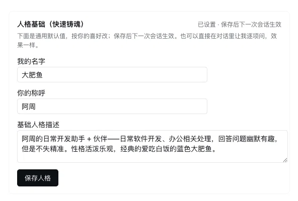
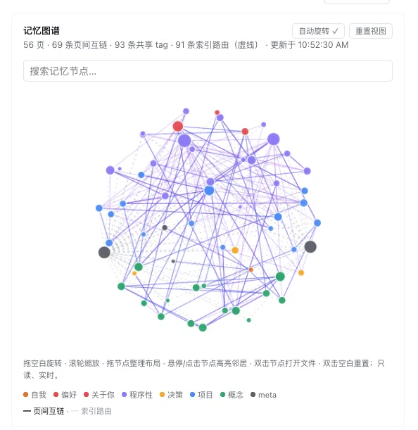
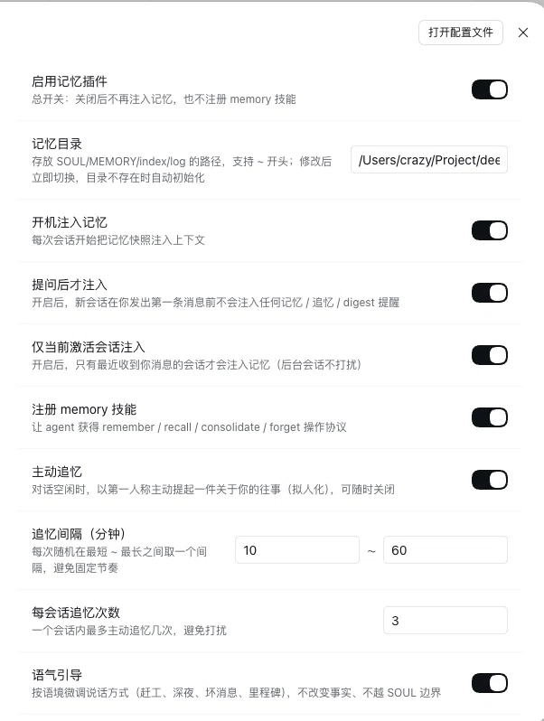

# dsh-plugin-memory

**English** ｜ [中文](README.zh.md)

<p align="center">
  <a href="https://github.com/LittleBlackTong/dsh-plugin-memory"></a>
  <a href="https://github.com/LittleBlackTong/dsh-plugin-memory/actions/workflows/ci.yml"></a>
  <a href="https://www.npmjs.com/package/dsh-plugin-memory"></a>
  
  
</p>

> Long-term memory for DeepSeek Harness — a portable markdown memory store with a soul, injected at every session start.

**macOS · Windows · Linux** · Node ≥ 18 · DSH `^0.2.1-rc.5` / `0.2.2-rc.2` · MIT

> **⚠️ Using DSH 0.2.2-rc.2 or newer? Upgrade the plugin to 0.19.2+ first.** Early 0.19.x reads `ctx.agents.roots()`, which rc.2 replaced with `list()`; the resulting throw happens inside the **serial** `agent/created` listener, which rejects agent registration — the visible symptom is **sessions can no longer be created while the plugin is enabled**. 0.19.2 reads the registry compatibly (never throws) and the change needs a **full DSH restart** to take effect `/memory` and the panel stay offline-safe meanwhile.

> **Compatibility is two-way.** 0.19.2+ reads the agent registry with `agents.roots()` first and falls back to `agents.list()`, so the same build runs on legacy hosts (0.2.1-rc.5 … 0.2.2-rc.1) *and* on rc.2. Upgrading the plugin never breaks an older DSH install, and rc.2 support does not drop older versions.

## What it does

A Cordis plugin that gives DSH agents **persistent, cross-session, migratable memory**: plain markdown + git (the *LLM Wiki* pattern), a `SOUL.md` persona, and a boot block **auto-injected through runtime context** — a hard guarantee, not a hope that the model decides to call a skill.

## Quickstart

```sh
# 1. install
dsh plugin --profile <profile> add dsh-plugin-memory
```

Or install from a **plugin index**: enable *Custom plugin indexes* under **Plugins → Experimental**, open **Discover → Add index source**, paste

```
https://raw.githubusercontent.com/LittleBlackTong/dsh-plugin-memory/main/docs/market/index.json
```

then install **Memory** from the list. (A JSON index in the official format, served from this repo.)

2. **Restart the app.** In the first session the agent starts the **soul-forging** conversation itself (or skip it: **Settings → Memory → Basic soul**, one save).
3. **Verify:** `dsh-memory doctor`, or open **Settings → Memory** for the health dashboard and hot settings.

## Features

- **Remembering across sessions** — boot block = SOUL + MEMORY protocol + `index.md` + recent activity, with a per-file budget so the index tail is not truncated first.
- **A soul, not just storage** — SOUL + BOOTSTRAP forging; a quick-setup card writes a managed block; persona names are read from SOUL, never hard-coded.
- **You stay in control** — per-session switch (chip / `/memory on|off` / panel) and `disabledWorkspaces` defaults.
- **A companion** — digest nudge, proactive recall, weekly growth recap, context-sensitive tone; shared speech floor with other proactive plugins.
- **Portable** — plain markdown + git, `pack`/`unpack`, optional auto-commit.
- **Memory graph** — interactive 3D sphere: rotate / zoom / drag nodes, search-to-focus, hover or click to light up neighbours; select a node → **Reveal in Finder** or **Copy path**; **double-click a node to open its file in the DSH sidebar** (falls back to the OS file manager).
- **Health tools** — dashboard, `checkup`, `lint`, `doctor`, automatic `last_access` stamping.
- **Zero build, bilingual panel, hot-editable config.**

## Screenshots

**Basic soul (quick forging)** — set the agent's name, what it calls you and a baseline persona in one save; the next session uses it, no restart. Chat-forged souls are echoed back from `SOUL.md`.



**Memory graph (3D)** — a live projection of the store: rotate / wheel-zoom / drag nodes to arrange, search-to-focus (the camera flies to the hit), hover or click to light up the neighbourhood. Select a node to **Reveal in Finder** or **Copy path**; double-click empty space to reset.



**Settings panel** — sixteen settings apply immediately (per-session switch, boot gates, recall cadence, tone, disabled workspaces…). The health dashboard and the graph sit right below.



## Cross-platform

**macOS, Windows and Linux are supported.** Path settings expand `~`, `~\`, `%USERPROFILE%` and `$HOME`; CRLF files are parsed as LF and **written back with their own newline style**; *Reveal in Finder* maps to `open -R` (macOS), `explorer /select,` (Windows, space-safe argv) and `xdg-open` (Linux); `disabledWorkspaces` matching is case-insensitive on Windows. Details: [docs/CONFIGURATION.md](docs/CONFIGURATION.md).

## Configuration

Seventeen hot keys edit live under **Settings → Memory** — including `bootSnapshot` (`live` by default; `session` freezes the boot block for the session so mid-session writes can't invalidate the prompt-prefix cache). The full table, boot-budget rules and composition overrides are in [docs/CONFIGURATION.md](docs/CONFIGURATION.md).

## CLI

```sh
dsh-memory init [dir]        # scaffold the store
dsh-memory search <query>    # full-text search
dsh-memory checkup           # one prioritised health report
dsh-memory doctor            # environment check-up
dsh-memory graph --suggest   # who should link to whom (report only)
dsh-memory pack / unpack     # move the store between machines
```

Store resolution: `$MEMORY_DIR` → `./.memory` → `~/.memory`.

## Docs

[Configuration](docs/CONFIGURATION.md) · [Design notes](docs/DESIGN.md) · [Migration](docs/MIGRATION.md) · [Proactive protocol](docs/PROACTIVE-PROTOCOL.md) · [Contributing](CONTRIBUTING.md) · [Security](SECURITY.md) · [Changelog](CHANGELOG.md)

## FAQ

**Does it burn tokens every request?** No — runtime context is deduplicated by projection; an unchanged payload is injected once.
**File skill vs plugin?** The file skill is a soft guarantee (only its blurb is injected); this plugin is a hard one. They coexist (the file skill ranks higher); remove any hand-written persona to avoid double injection.
**Where should the store live?** `~/.memory` by default; point `memoryDir` inside a project for isolation.

## Development

```sh
git clone https://github.com/LittleBlackTong/dsh-plugin-memory.git
cd dsh-plugin-memory
node scripts/memory.mjs --self-test   # smoke test, nothing to install
node --test                          # full suite
```

Zero build: `lib/` is runtime code as-is. CI runs both commands.

## Roadmap

- [ ] Embedding / BM25 retrieval
- [ ] MCP server for non-DSH agents
- [ ] Encrypted store option
- [ ] TypeScript rewrite

## Feedback & community

- **Bugs / features / PRs**: [open an issue](https://github.com/LittleBlackTong/dsh-plugin-memory/issues) — that is where feedback and questions are tracked.
- **WeChat group**「dsh-plugin-memory 插件沟通」: scan below (QR codes expire every ~7 days; open an issue if it no longer works).


## License

[MIT](LICENSE)
