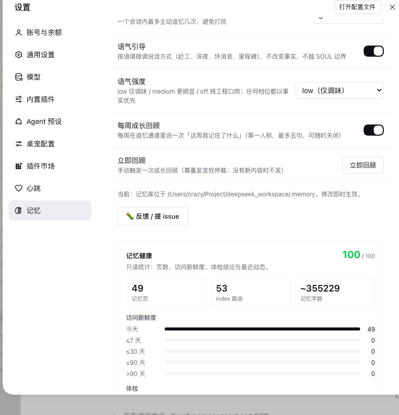

# dsh-plugin-memory

**English** ｜ [中文](README.zh.md)

<p align="center">
  <a href="https://github.com/LittleBlackTong/dsh-plugin-memory"></a>
  <a href="https://github.com/LittleBlackTong/dsh-plugin-memory/actions/workflows/ci.yml"></a>
  <a href="https://www.npmjs.com/package/dsh-plugin-memory"></a>
  
  
</p>

> A long-term memory plugin for DeepSeek Harness: a cross-session, portable, markdown memory store that comes with a soul.

> Together, let's bring the complete *Blue Big Fat Fish* (蓝色大肥鱼) to life — sooner rather than later.

A Cordis plugin for [DeepSeek Harness](https://github.com/deepseek-ai/deepseek-harness) that gives agents persistent, cross-session, migratable long-term memory: a markdown + git store (inspired by Karpathy's *LLM Wiki* pattern) with a `SOUL.md` persona file, **auto-injected at every session start** through the system-prompt runtime context, plus remember / recall / consolidate / forget workflows and portable CLI tooling.

## Quickstart

Three steps, about five minutes:

```sh
# 1. install
dsh plugin --profile <profile> add dsh-plugin-memory
```

2. **Restart the app**, open a session and say anything. The boot block loads automatically — and because the store has no soul yet, the agent **starts the soul-forging conversation by itself**: what its name is, how to address you, what you are to each other, what personality it should have. Answer as much or as little as you like; each answer is written back.

3. **Confirm it took.** `dsh-memory doctor` gives an environment check-up (scaffold, orphan pages, git state, boot budget) and ends with the command that fixes each finding. Or open **Settings → Memory** for the health dashboard and hot-editable options.

After that the loop is simple: the agent writes memories back as you work, and you can steer the store by hand whenever you like — it is plain markdown plus git, nothing locked in.

## Features

- **Mandatory boot injection (with routing-table protection)**: the plugin injects a memory boot block (`SOUL.md` persona + `MEMORY.md` protocol + `index.md` directory + recent activity) into the session context via `ctx.systemPrompt.context()`. The host deduplicates by projection: an unchanged memory is injected once, and a changed memory replaces the previous snapshot — this is the **hard guarantee** that a new session always loads memory first, rather than hoping the model calls a skill. The total budget is `bootMaxChars`, **allocated per file**: every file first gets an equal share (capped by its real size), and the remaining budget goes to `index.md` first, then to files that still have content left — so as the store grows, the tail of the directory is not the first thing to be truncated (see "boot budget allocation"). Two polite gates ship enabled by default: `deferUntilUserSpeaks` (inject only after the user speaks) and `activeSessionOnly` (inject only into the currently active session) — see "Configuration".
- **Automatic `last_access` stamping**: the salience decay rules in `MEMORY.md` depend on `last_access`, which used to be pure self-discipline — the field existed in the template and the rules mentioned it, but no code ever wrote it, so every page silently aged and the decay table was decorative. Now, on the first real user message of a session, the plugin stamps today's date onto the pages the boot block **actually injected** (`SOUL.md` / `MEMORY.md` / `index.md` plus the pages the directory references) — once per session, idempotent per day, touching only the `last_access` line. `dsh-memory touch <pages...>` backfills manually; `trackPageAccess: false` disables it.
- **SOUL.md soul-forging**: right after installation, the first task is a conversation with the user to define a soul (name, personality, values, tone, boundaries) and to confirm identity and relationship, driven by the `BOOTSTRAP.md` checklist, which takes priority over ordinary tasks until complete.
- **Automatic soul-forging guidance**: while the store has no soul yet (`BOOTSTRAP.md` not complete, or `SOUL.md` still the placeholder template), the boot block prepends a first-person prompt — "my first job is to establish who I am and who you are: what my name is, what to call you, what we are to each other, and what personality I should have" — so the agent **starts the forging conversation itself**, item by item, writing each answer back, OpenClaw-style, instead of waiting to be fed. The prompt disappears once forging completes, at zero cost.
- **Compounding memory**: follows Karpathy's *LLM Wiki* convention — memory is a durable artifact that is compiled once and kept fresh, not re-RAG'd per query. Four operations (remember / recall / consolidate / forget) plus three-level salience decay.
- **Portable**: the store is plain markdown + git + a self-describing schema; any agent that reads markdown can take it over. `dsh-memory pack/unpack` moves it between machines.
- **Embedded skill**: registers the `memory` skill through `ctx.skills.register()` (the operating protocol ships with the plugin); a project-level `.dsh/skills/memory` file skill can still override it.
- **Anti-laziness digest nudge**: after a turn ends, if the agent sits idle and the store has not been written for `digestNudgeAfterMinutes`, the plugin injects a digest reminder (a synthetic message through `agent.followup`), turning "settle the session at the end" from self-discipline into a mechanism, with cooldown and a per-session cap so it never nags. **Independent of dsh-plugin-heartbeat** — either plugin can be installed alone.
- **Proactive recall (personification)**: when the conversation goes quiet, the plugin brings up, in the first person, one thing it **genuinely remembers** about you or the two of you (a preference, a past event, an open decision, recent progress) — turning memory from "write-only" into something actually used, the way an old friend naturally recalls something rather than reporting status. The interval is **randomised** between a minimum and a maximum (no fixed rhythm), paired with a per-session cap: no nagging, no fabrication, no forcing conversation. Purely conversational; it never writes the store. **Also independent of heartbeat**.
- **Automatic git commits**: after `autoCommitQuietSeconds` of quiet, store changes are silently `git add -A && git commit` (skipped when there is no `.git`) — history becomes rollback-able without depending on the agent remembering to commit.
- **Settings panel**: a "Memory" section in the DSH settings page — master switch, store directory, boot injection, skill registration, and proactive recall (switch + random interval range + per-session cap) are all hot-editable and take effect immediately, no restart.
- **Automatic index upkeep (declarative compilation)**: index lines are no longer hand-written. A page declares `summary:` in its frontmatter, and `dsh-memory index --write` rewrites the line as a projection of it (tag ≤32 / summary ≤48 / whole line ≤132 characters), **changing only line content while preserving sections and order byte for byte**, and idempotently. `index --check` gives a machine verdict (non-zero exit when there is drift), and `index --sync-frontmatter` backfills summaries already written in the index into the pages (a one-off migration for older stores). The digest reminder appends a note when the index has drifted, so the agent can fix it in passing.
- **Cross-linking as a default action**: `index.md` is the directory (who exists); page-to-page links are the **relationships** (who relates to whom). In a real store measured here, 29 pages had only 1 genuine cross-link, yet the graph and all cross-page synthesis rest on that layer. Three places now push it together: the remember flow in `skills/memory.md`, the workflow in the `MEMORY.md` template, and the closing instruction of the digest reminder all require "add 1–3 related-page links for every page you touched this time".
- **Link suggestions**: `dsh-memory graph --suggest` lists, for pages that have only their index entry and no content relationship, who they ought to reference — scored by shared topic tags, title words, and same type, with the reason stated (`shared #dsh` / `title word dsh` / `same type`). Report-only: whether and how to link stays the agent's call. Also available as `GET /api/memory/graph?suggest=1`.
- **Memory graph**: a read-only relationship graph in the settings page — not just the `index.md` star (the index is connected to everything), but the relationships pages **already encode and nobody ever drew**: index routing (`index.md` points at every page — the largest edge set in the store, 43 edges; earlier versions skipped meta files, which left the index stranded on the graph), explicit markdown links between pages (with relative path resolution), and shared frontmatter tags (generic container tags like `project`/`skill` are ignored; dense tags go through an anchor chain rather than all-to-all). Coordinates are computed once on the server by `lib/graph-layout.js` (deterministic, no randomness, no dependencies); the client only draws SVG. **Interactive**: wheel zoom (cursor-centred, 0.4×–2.5×, non-passive listener so the settings page does not scroll along), drag empty space to pan, `Reset view` to return to the whole graph; hold a node to drag it, direct neighbours follow slightly by distance, and it eases back to the layout on release — transitions pause during a drag for 1:1 tracking, using an O(neighbours) local relaxation instead of a per-frame full force simulation (which stalls at a few hundred pages). Hover highlights the neighbourhood; the first render blooms out from the centre (respecting `prefers-reduced-motion`). The graph **auto-refreshes every 25 seconds** (changes appear while the panel is open, with "updated at HH:MM:SS" in the subtitle); a failed fetch keeps the previous graph instead of clearing it. The view maths (`zoomAt`/`panBy`/`toGraphPoint`) are pure functions in `lib/graph-view.js` with tests — "the zoom centre must not drift" is pinned down. `GET /api/memory/graph` (read-only, live; `?types=1` adds weak same-type edges). Three edge kinds are distinguishable: page links = solid blue, index routing = grey dashed, shared tags = thin lines.
- **`dsh-memory checkup`**: folds the four readers (lint's integrity, status's counts, the dashboard's size and freshness, graph's relationships) into **one prioritised report** — size, freshness bars, connectivity, consistency checks, ending with "the N things most worth doing". The four numbers are diagnosis; "do these three things" is the product. Exits non-zero when there is work to do, so scripts can consume it. `--boot=N` computes the index share against your boot budget.
- **Memory health dashboard**: below the same section is a **read-only** dashboard — memory pages / index routes / word count, an access-freshness bar chart (today / ≤7 / ≤30 / ≤90 / >90 days), four health verdicts (index links, orphan pages, frontmatter, freshness) with a health score, stale-page candidates, and the 5 most recent log entries. Data comes from the new `GET /api/memory/insights` (computed live per request, never cached), and its criteria share a source with `dsh-memory lint`, so the dashboard and the CLI cannot contradict each other.
- **Zero build**: plain ESM JavaScript, no compilation step, usable straight after `pnpm add`.

## Persona, politeness and growth (v0.12.0)

Four small additions turn the memory from "storage with a soul" into a companion that behaves:

- **Speech-right arbitration with other proactive plugins (A)**: before sending anything proactive — a recall, a digest reminder or a growth recap — the plugin claims the shared `${DSH_HOME:-~/.dsh}/proactive-cooldown.json` (`{ version: 1, speaker: 'memory' | 'heartbeat', at: <epoch ms> }`, atomic tmp+rename). If another speaker claimed inside `proactiveCooldownSeconds` (default **180**, `0` disables), the message is deferred and **the cadence is not consumed** — the next trigger retries. Neither plugin imports the other; both implement the same protocol independently, so either can be installed, upgraded or removed alone.
- **Tone drift (B)**: `lib/tone.js` injects a small `## Tone (adapt to context)` section right after SOUL (≤12 lines, **charged to the boot budget** — its character cost is deducted before the per-file allocation): crunch/urgent fix → short sentences, conclusion first, zero jokes; deep night (23:00–06:00) → shorter and gentler; errors/bad news → facts and the fix before any feelings; milestone/finished → one light line, then back to business. `toneGuideEnabled` (default `true`) switches it, `toneIntensity` (`low` / `medium` / `off`, default `low`) sets how visible it is.
- **Expression, never fake emotion (C)**: the same section draws the line — describe the **observed situation and care**, never claim inner feelings ("I am … / I feel …"); only three occasions are allowed: risk/bad news, milestones/completion, and the first line after 3+ days without contact.
- **Weekly growth recap (D)**: `growthRecapEnabled` (default `true`) and `growthRecapIntervalDays` (default `7`). It rides the **recall channel** (same cadence, same per-session cap, same arbitration lock) and reads only what the store already proves — recent `log.md` headlines and page mtimes — so there is no invented progress. `<store>/.growth-recap.json` remembers the last delivery, so a restart does not repeat the same week.

## Architecture

The plugin owns the **workflow**, never the **data format**:

```
dsh-plugin-memory (this plugin)
├── lib/index.js        # Cordis entry: boot injection + runtime skill registration + settings hot-edits
├── lib/boot.js         # boot block rendering (SOUL/MEMORY/index + recent log, budgeted per file)
├── lib/pages.js        # page access accounting: extractReferencedPages / touchPages (last_access)
├── lib/insights.js     # data layer for the health dashboard (pages/distribution/freshness/checks, read-only)
├── lib/activity-tracker.js # the two polite gates: has the user spoken + is this the active session
├── lib/digest-guard.js # anti-laziness digest nudge (idle + store unwritten -> followup reminder)
├── lib/recall-nudge.js # proactive recall (idle -> one true recollection in the first person, never writes)
├── lib/scaffold.js     # store scaffolding (templates are created, never overwritten)
├── lib/client.js       # client half: the "Memory" settings section + health dashboard
├── skills/memory.md    # the embedded skill's operating protocol
└── scripts/memory.mjs  # CLI: init/search/touch/lint/status/pack/unpack

The store (your data, default ~/.memory)
├── SOUL.md       # persona and soul (user-owned)
├── BOOTSTRAP.md  # soul-forging checklist (takes priority until complete)
├── MEMORY.md     # schema and maintenance protocol (self-describing)
├── index.md      # page directory    log.md # timeline (append-only)
├── identity/ user/ skills/ decisions/ projects/{active,archive}/ concepts/
└── raw/          # immutable source material
```

## Installation

```sh
dsh plugin --profile <profile> add dsh-plugin-memory
```

(The package ships a `dsh.bundle` manifest, so `dsh plugin add` mounts it into the profile's bundles layer automatically; one-click install from dsh-market uses the same channel.)

Restart the profile (restart the DSH Desktop app) to take effect.

> 📌 **Version requirement: DSH session format v4 + official DeepSeek Harness 0.2.1-rc.5 series** (0.13.x declares `engines.dsh`; older hosts are refused by the gate — see [Compatibility](#compatibility))
>
> Injected messages use the producer-owned source kind `plugin:memory`. v4's native admission explicitly rejects the v3-era `{ kind: 'plugin', plugin: 'memory' }` wrapper with
> `format v4 message requires a producer-owned source kind` (the error is wrapped as `code: "UNKNOWN"`, so it surfaces in the UI as `... source kind UNKNOWN` — `UNKNOWN` is the error code, not a kind value).
>
> The v4 and v3 whitelists are **mutually exclusive** (v3 only recognises `plugin`), so one build cannot support both. **0.8.0 and earlier trigger this error on v4**; older DSH should stay on 0.8.0.

> ⚠️ Do **not** hand-write `- insert: {id: dsh-memory, ...}` into the profile's `cordis.patch.yml`: that produces two entries with the same name alongside the bundle manifest's automatic mount, and the whole profile fails to start with `duplicate loader entry id "dsh-memory"` (a real incident on 2026-08-18). Runtime settings (enabled / memoryDir / autoInject / registerSkill / recallEnabled) go through `<dshHome>/memory.json` (hot-edited from the settings panel); composition settings are in the table below. To override a composition key, use an **id override entry without `insert`** (see Configuration).

## Configuration

| Key | Default | Meaning |
|---|---|---|
| `enabled` | `true` | Master switch: when off, no boot injection and no `memory` skill registration |
| `memoryDir` | `~/.memory` | Absolute path to the store (`~` is expanded) |
| `bootFiles` | `[SOUL.md, MEMORY.md, index.md]` | Files injected at session start |
| `bootMaxChars` | `12000` | Total character budget for the boot block (keeps context usage bounded); per-file allocation below |
| `bootFileBudgets` | — | Per-file character caps, e.g. `{ index.md: 3500 }`; unlisted files share the remainder (composition layer, restart required) |
| `trackPageAccess` | `true` | On the session's first user message, stamp `last_access` on the pages the boot block actually injected (when off, the decay table needs manual upkeep) |
| `autoInject` | `true` | Inject the boot block at session start |
| `deferUntilUserSpeaks` | `true` | Inject only after the user's first real message (the boot block, recall and digest reminders all obey it); hot-editable |
| `activeSessionOnly` | `true` | Inject only into the "currently active session" (the one that most recently received a user message); background sessions are left alone; hot-editable |
| `registerSkill` | `true` | Register the embedded `memory` skill |
| `scaffold` | `true` | Create the store templates when missing (create only, never overwrite) |
| `configFile` | `<dshHome>/memory.json` | Path to the user-editable JSON config (read/written by the settings panel) |
| `digestNudgeEnabled` | `true` | Master switch for the anti-laziness digest reminder (composition) |
| `digestNudgeAfterMinutes` | `120` | How long the store may go unwritten before reminding |
| `digestNudgeCooldownMinutes` | `180` | Minimum gap between two reminders |
| `digestNudgeMaxPerSession` | `2` | Maximum reminders per session |
| `recallEnabled` | `true` | Master switch for proactive recall (hot-editable) |
| `recallIntervalMinMinutes` | `30` | Lower bound of the random interval (minutes, hot-editable) |
| `recallIntervalMaxMinutes` | `240` | Upper bound of the random interval (minutes, hot-editable) |
| `recallMaxPerSession` | `3` | Maximum recalls per session (hot-editable) |
| `proactiveCooldownSeconds` | `180` | Shared speech-floor cooldown against other proactive plugins (`0` = off) |
| `toneGuideEnabled` | `true` | Inject the context-sensitive tone section after SOUL |
| `toneIntensity` | `low` | `low` / `medium` / `off` (pure engineering voice) |
| `growthRecapEnabled` | `true` | Weekly growth recap on the recall channel |
| `growthRecapIntervalDays` | `7` | Days between growth recaps |
| `autoCommit` | `true` | Git auto-commit switch for the store (composition) |
| `autoCommitQuietSeconds` | `60` | How long changes must be quiet before committing (debounce) |
| `autoCommitIntervalSeconds` | `60` | Change polling interval |

### Settings panel (hot edits)

The section is registered as **"Memory"** in the English UI and **「记忆」** in the Chinese UI — it follows DSH's own language setting (see [Language](#language) below).

Fifteen settings are editable in the "Memory" section of the DSH settings page and take effect **immediately**: `enabled` / `memoryDir` / `autoInject` / `deferUntilUserSpeaks` / `activeSessionOnly` / `registerSkill` / `recallEnabled` / `recallIntervalMinMinutes` / `recallIntervalMaxMinutes` / `recallMaxPerSession` / `proactiveCooldownSeconds` / `toneGuideEnabled` / `toneIntensity` / `growthRecapEnabled` / `growthRecapIntervalDays` — boot injection, the two polite gates, skill registration, proactive recall (including its random interval and cap), speech-right arbitration, the tone section and the weekly growth recap all follow the change at once; switching the store directory scaffolds the new one automatically (when `scaffold: true`). The remaining keys (`bootFiles` / `bootMaxChars` / `bootFileBudgets` / `trackPageAccess` / `scaffold` / `configFile` / `digestNudge*` / `autoCommit*`) only apply at the composition layer and need a restart.

A **Review now** button sits beside them: it is a **control, not a setting** — it asks the plugin to send one growth recap immediately. It still respects the speech floor (it backs off if the other plugin is speaking), sends nothing when this week has no new material, works even while `recallEnabled` is off, and reports the outcome in the panel (sending / sent / deferred / session busy / no content / disabled / failed) — the result notice clears itself after 5 seconds.



### Language

The settings panel and its sidebar label follow DSH's own language setting (**Settings → General → Language**) and switch live — no restart: Chinese shows 「记忆」, English shows "Memory". Panel copy is registered as the `memory` locale namespace through `ctx.locale`, so the renderer re-renders the whole panel (form, health dashboard, graph card) in the active language and injects a `t(key)` seat into the section. The sidebar icon claim key is derived from that same label, so a language switch re-claims the right row. The dashboard's health-check labels **and details** are rebuilt client-side from locale-neutral `data` the insights route ships (`lib/insights.js` keeps the Chinese `label`/`detail` strings for the CLI); an older host payload without `data` falls back to those Chinese strings. User content (page titles, `log.md` headlines) and the CLI's own Chinese output are content, not UI copy, and stay as-is.

### Compatibility

`package.json` declares `engines.dsh: "^0.2.1-rc.5"`, and the host enforces it with `semver.satisfies(..., { includePrerelease: true })` — the prerelease detail matters: `^0.2.1` or `>=0.2.0` do **not** match `0.2.1-rc.5`, so only the explicit prerelease range works (it also covers the eventual 0.2.1 stable). Two host services became load-bearing on the way here: the `locale` service (0.11+: the panel registers its dictionaries through it) and session projections (0.12+: speech arbitration and the growth recap read them). On an older host the gate refuses to load the plugin instead of letting it run half-broken; at runtime a missing projection still degrades gracefully — no recap, no speech-floor claim, never a crash.

### Boot budget allocation (why the index is not truncated first)

`bootMaxChars` is a total budget, allocated per file rather than split evenly:

1. Files with a `bootFileBudgets` entry take their own allowance first;
2. the remaining files each get an equal share, **capped by their real size** — a short file returns its unused allowance to the pool;
3. the pool then tops up files that still have content left to inject (each up to twice the equal share): **`index.md` first**, then the rest by descending size — so which file gets truncated is decided by size, not by the order in `bootFiles`.

When every file is under the equal share, the result is byte-for-byte identical to the old even-split rule; it only diverges once the store grows. This also means: **`index.md` is a routing table, not a summary table** — it is injected in full, and bloat costs you the persona and other memories.

> **How is the "currently active session" decided?** The DSH host has no "currently focused session" signal (active session is a front-end concept). The plugin uses **the live root agent that most recently received a real user message** as a proxy: whichever session you speak in is the active one; switching away without sending a message is invisible to the host (a known limit of the proxy). Exact "expanded/focused" precision would need a small client-side focus report.

### Memory health dashboard

Below the "Memory" section is a **read-only** dashboard fed by `GET /api/memory/insights`:

| Display | Meaning |
|---|---|
| pages / index routes / word count | Store size (counted in characters, so Chinese is not inflated 3× by bytes) |
| Health score (0–100) | Weighted from orphan pages, missing `salience`/`type`, stale pages, and broken index links |
| Access freshness bars | today / ≤7 / ≤30 / ≤90 / >90 days / never stamped (driven by automatic `last_access` stamping) |
| Four checks | Index links complete, no orphan pages, frontmatter complete, access freshness — same source as `dsh-memory lint` |
| Stale candidates | Pages older than 90 days or never stamped, sorted by staleness (top 8) |
| Recent activity | The 5 newest `log.md` headlines |

The dashboard is **live**: refetched each time the settings page opens (or after any config change), never persisted, cached, or written back to the store. On a headless deployment without `webServer`, that route and the dashboard simply do not exist; everything else is unaffected.

To override a composition key (for example raising the boot budget), write an **id override entry without `insert`** in the profile's `cordis.patch.yml`:

```yaml
- id: dsh-memory
  config:
    bootMaxChars: 12000
```

> Implementation note: DSH's settings wire only serves a hard-coded namespace allowlist, so a plugin namespace cannot be written through it. This plugin therefore uses its own channel: config lives in `<dshHome>/memory.json` (schema-validated, atomically written), served by the plugin's self-registered `GET/POST /api/memory/config` routes, which the client section fetches directly.

## First run: soul-forging

After installation, the agent's first task in the first session is **not** to work, but to talk with you about its soul: name, personality, values, tone, boundaries, plus who you are and what you are to each other. Each item is confirmed and written back to `SOUL.md` / `user/profile.md` until `BOOTSTRAP.md`'s `status` becomes `complete`. You can skip or defer at any time.

## The four operations

- **remember**: distil what is worth persisting into pages, updating `index.md` and appending to `log.md` in the same pass. Keep routing-table discipline when maintaining the index: one line per page, a one-sentence summary (≤ 80 characters) plus `salience`.
- **recall**: read the boot block at session start; on a query, consult `index.md` first and then drill into pages; use `dsh-memory search <keywords>` when needed.
- **consolidate**: `dsh-memory lint` finds contradictions, orphans, and cold pages due for archiving; `dsh-memory status` shows the stale-page distribution.
- **forget**: explicit forgetting happens immediately; automatic decay follows salience + last_access (cold pages are archived first). `last_access` is maintained by the plugin — no manual edits.

## CLI

```sh
dsh-memory init [dir]                 # create the store scaffold
dsh-memory search <query> [--touch]   # full-text search (--touch stamps hits with last_access)
dsh-memory touch [pages...]           # stamp last_access manually (no args = every page)
dsh-memory graph --suggest            # relationship report + "who should this page link to" (report only)
dsh-memory query --type decision --tag dsh --hot --stale [keywords]
                                      # structured query: filter by frontmatter, then match the body
dsh-memory checkup [--boot=N]         # one report: size/freshness/connectivity/consistency + prioritised actions
dsh-memory lint                       # integrity check
dsh-memory doctor                     # environment check-up + the command that fixes each finding
dsh-memory status                     # health overview (including stale-page counts)
dsh-memory pack [out.tar.gz]          # export an archive (with manifest)
dsh-memory unpack <archive> [--force] # restore from an archive
```

Store resolution order: `$MEMORY_DIR` → `./.memory` (when present) → `~/.memory`.

## Migration

The store is plain markdown + git: copying it *is* the migration. Cross-machine, cross-agent, and capability-degradation tiers are covered in [docs/MIGRATION.md](docs/MIGRATION.md).

## FAQ

**Q: How does this relate to a hand-written `.dsh/skills/memory` file skill?**
The file skill is a *soft* guarantee (only the skill's blurb is injected; the body depends on the model choosing to load it). This plugin is a *hard* guarantee (the boot block rides the system prompt's runtime context automatically). They can coexist: the file skill (rank 100) overrides the plugin's embedded skill (rank 250). If you previously edited the system prompt persona (say a boot instruction in a profile patch) to get the soft guarantee, **remove that persona** after installing this plugin to avoid double injection.

**Q: Does the boot block get re-injected on every request and burn tokens?**
No. Runtime context is deduplicated by projection: an unchanged payload is injected once, and an updated memory replaces the old snapshot.

**Q: Where should the store live?**
`~/.memory` by default (global, cross-project). For per-project isolation, point `memoryDir` inside the project, or let the agent maintain `.memory/` there.

**Q: Can it be encrypted?**
If the memory holds sensitive content, put `memoryDir` on an encrypted volume or in a private repository. The format is unchanged and the plugin is unaware.

## Development

```sh
git clone https://github.com/LittleBlackTong/dsh-plugin-memory.git
cd dsh-plugin-memory
node scripts/memory.mjs --self-test   # smoke test (no dependencies to install)
```

Zero build: `lib/` is runtime code as-is, and `lib/types/index.d.ts` serves TypeScript consumers. `boot.js` / `scaffold.js` depend only on `node:*` built-ins and can be reused standalone.

The test suite (`node --test`) currently holds **260 tests**, and CI (`.github/workflows/ci.yml`) runs it together with `node scripts/memory.mjs --self-test`. Contribution and security policies live in [CONTRIBUTING.md](CONTRIBUTING.md) and [SECURITY.md](SECURITY.md); the cross-plugin speech-floor protocol is documented in [docs/PROACTIVE-PROTOCOL.md](docs/PROACTIVE-PROTOCOL.md).

## Roadmap

- [ ] TypeScript rewrite (full types and a build step)
- [ ] Embedding/BM25 retrieval (replacing index-first lookup past a few hundred pages)
- [ ] MCP server (so non-DSH agents can use the same store)
- [ ] GitHub Actions CI (running `--self-test` and lint)
- [ ] Encrypted memory storage option

Requests, bug reports, and pull requests are welcome in [Issues](https://github.com/LittleBlackTong/dsh-plugin-memory/issues).

## License

[MIT](LICENSE)
