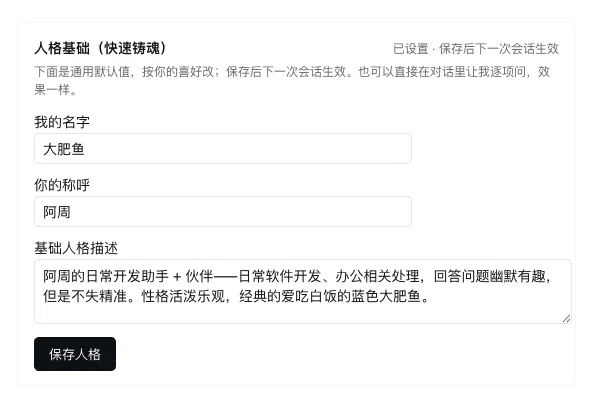
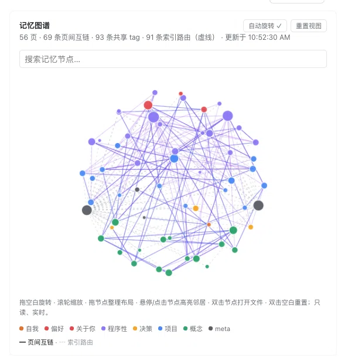
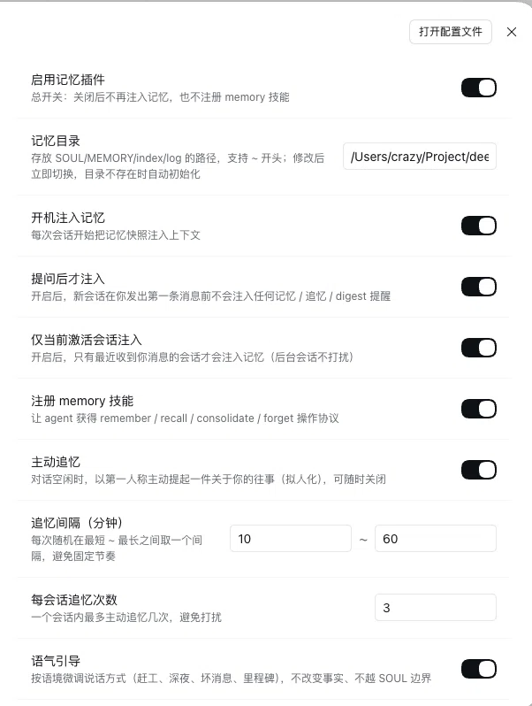

# dsh-plugin-memory

[English](README.md) ｜ **中文**

<p align="center">
  <a href="https://github.com/LittleBlackTong/dsh-plugin-memory"></a>
  <a href="https://github.com/LittleBlackTong/dsh-plugin-memory/actions/workflows/ci.yml"></a>
  <a href="https://www.npmjs.com/package/dsh-plugin-memory"></a>
  
  
</p>

> 给 DeepSeek Harness 的长期记忆 —— 一个可迁移的 markdown 记忆库，还带一份灵魂，每次会话启动自动注入。

**macOS · Windows · Linux** 全平台支持 · Node ≥ 18 · DSH `^0.2.1-rc.5` · MIT

## 它是干什么的

一个 Cordis 插件，给 DSH 的 agent 装上**跨会话、可迁移的持久记忆**：纯 markdown + git（*LLM Wiki* 模式）、一份 `SOUL.md` 人格，以及通过 runtime context **自动注入的 boot 块**——硬保证，不靠模型自觉去调 skill。

## 快速开始

```sh
# 1. 安装
dsh plugin --profile <profile> add dsh-plugin-memory
```

2. **重启应用**。第一个会话里 agent 会**主动发起铸魂对话**（不想聊也行：**设置 → 记忆 → 人格基础**，一次保存）。
3. **验证**：`dsh-memory doctor`，或打开 **设置 → 记忆** 看健康看板与热改配置。

## 功能

- **跨会话记得住** —— boot 块 = SOUL + MEMORY 协议 + `index.md` + 最近动态，按文件分配预算，index 尾部不会先被截断。
- **有灵魂，不只是存储** —— SOUL + BOOTSTRAP 铸魂；快速铸魂卡片写入受管区块；人格名从 SOUL 读取，绝无硬编码。
- **你说了算** —— 会话级开关（chip / `/memory on|off` / 面板）+ `disabledWorkspaces` 工作区默认。
- **像个搭子** —— digest 提醒、主动追忆、每周成长回顾、按语境调语气；与其它主动插件共享发言权仲裁。
- **可迁移** —— 纯 markdown + git，`pack`/`unpack` 搬家，可选自动提交。
- **记忆图谱** —— 可交互 3D 球面：旋转/缩放/拖节点整理、搜索定位、悬停或点击点亮邻居；选中节点可 **在 Finder 中显示** 或 **复制路径**。
- **健康工具** —— 看板、`checkup`、`lint`、`doctor`、自动 `last_access`。
- **零构建、面板双语、配置热改。**

## 界面预览

**人格基础（快速铸魂）** —— 一次保存我的名字 / 你怎么称呼我 / 基础人格，下次会话直接生效、不用重启；对话铸魂的老库也会从 `SOUL.md` 回显。



**记忆图谱（3D）** —— 记忆库的实时投影：旋转 / 滚轮缩放 / 拖节点整理，搜索即飞镜头定位，悬停或点击点亮邻居；选中节点可 **在 Finder 中显示** 或 **复制路径**，双击空白重置。



**设置面板** —— 十六项设置即时生效（会话开关、注入闸门、追忆节奏、语气、工作区默认…），健康看板与图谱就在下面。



## 跨平台（含 Windows）

**macOS、Windows、Linux 都支持。** 路径配置里的 `~`、`~\`、`%USERPROFILE%`、`$HOME` 会自动展开；CRLF 文件按 LF 解析、**写回保留文件自身换行风格**（不会被强行 LF 化）；「在 Finder 中显示」在 macOS 是 `open -R`、Windows 是 `explorer /select,`（参数分开传，含空格路径安全）、Linux 是 `xdg-open`；`disabledWorkspaces` 在 Windows 上大小写不敏感。细节见 [docs/CONFIGURATION.md](docs/CONFIGURATION.md)。

## 配置

十六个热改项在 **设置 → 记忆** 里即时生效。完整配置表、boot 预算规则与组合层覆盖示例见 [docs/CONFIGURATION.md](docs/CONFIGURATION.md)。

## CLI

```sh
dsh-memory init [dir]        # 生成记忆库脚手架
dsh-memory search <query>    # 全文搜索
dsh-memory checkup           # 一份带优先级的健康报告
dsh-memory doctor            # 环境体检 + 修复命令
dsh-memory graph --suggest   # 谁该链接到谁（只报告）
dsh-memory pack / unpack     # 记忆库打包 / 恢复
```

记忆库解析顺序：`$MEMORY_DIR` → `./.memory` → `~/.memory`。

## 文档

[配置](docs/CONFIGURATION.md) · [设计说明](docs/DESIGN.md) · [迁移](docs/MIGRATION.md) · [主动消息协议](docs/PROACTIVE-PROTOCOL.md) · [贡献](CONTRIBUTING.md) · [安全](SECURITY.md) · [更新日志](CHANGELOG.md)

## FAQ

**每次请求都烧 token 吗？** 不会——runtime context 按投影去重，没变化只注入一次。
**文件技能和插件的关系？** 文件技能是软保证（只注入说明），本插件是硬保证；两者可共存（文件技能优先级更高），手写 persona 要删掉以免重复注入。
**记忆库放哪？** 默认 `~/.memory`；按项目隔离就把 `memoryDir` 指进项目里。

## 开发

```sh
git clone https://github.com/LittleBlackTong/dsh-plugin-memory.git
cd dsh-plugin-memory
node scripts/memory.mjs --self-test   # 冒烟测试，无需安装依赖
node --test                          # 全量测试
```

零构建：`lib/` 直接就是运行时代码。CI 跑上面两条。

## Roadmap

- [ ] Embedding / BM25 检索
- [ ] MCP server（让非 DSH 的 agent 共用记忆库）
- [ ] 记忆加密存储
- [ ] TypeScript 重写

## 反馈与交流

- **报 bug / 提需求 / 交 PR**：[提 issue](https://github.com/LittleBlackTong/dsh-plugin-memory/issues)。
- **微信群**「dsh-plugin-memory 插件沟通」：扫下面的码（二维码约 7 天过期；失效请提 issue）。


## License

[MIT](LICENSE)
