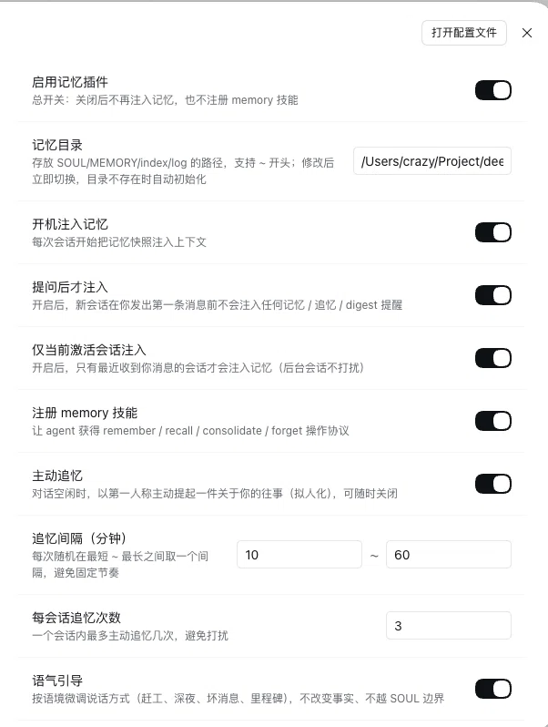

# Configuration reference

All keys below are read from the composition layer (`cordis.patch.yml`) unless marked **hot**: those live in `<DSH_HOME>/memory.json`, are served by the panel's `/api/memory/config` routes and take effect immediately.

| Key | Default | Meaning |
|---|---|---|
| `enabled` **hot** | `true` | Master switch: off means no boot injection and no `memory` skill |
| `memoryDir` **hot** | `~/.memory` | Store directory (`~`, `~\`, `%USERPROFILE%`, `$HOME` expanded) |
| `autoInject` **hot** | `true` | Inject the boot block at session start |
| `deferUntilUserSpeaks` **hot** | `true` | Inject only after the user's first real message |
| `activeSessionOnly` **hot** | `true` | Inject only into the most recently spoken-to session |
| `registerSkill` **hot** | `true` | Register the embedded `memory` skill |
| `recallEnabled` **hot** | `true` | Proactive recall switch |
| `recallIntervalMinMinutes` **hot** | `30` | Lower bound of the random recall interval |
| `recallIntervalMaxMinutes` **hot** | `240` | Upper bound of the random recall interval |
| `recallMaxPerSession` **hot** | `3` | Per-session recall cap |
| `proactiveCooldownSeconds` **hot** | `180` | Shared speech floor against other proactive plugins (`0` = off) |
| `toneGuideEnabled` **hot** | `true` | Inject the context-sensitive tone section after SOUL |
| `toneIntensity` **hot** | `low` | `low` / `medium` / `off` |
| `growthRecapEnabled` **hot** | `true` | Weekly growth recap on the recall channel |
| `growthRecapIntervalDays` **hot** | `7` | Days between growth recaps |
| `disabledWorkspaces` **hot** | `[]` | Session cwd patterns that default to memory off (`~` expanded, path-boundary match, case-insensitive on Windows) |
| `bootFiles` | `[SOUL.md, MEMORY.md, index.md]` | Files injected at session start |
| `bootMaxChars` | `12000` | Total boot-block character budget |
| `bootFileBudgets` | — | Per-file caps, e.g. `{ index.md: 3500 }` |
| `trackPageAccess` | `true` | Stamp `last_access` on every page the boot block actually injected |
| `scaffold` | `true` | Create missing store templates (never overwrites) |
| `configFile` | `<DSH_HOME>/memory.json` | Hot config file |
| `sessionStateFile` | `<DSH_HOME>/memory-sessions.json` | Per-session overrides |
| `sessionTtlDays` | `7` | Override lifetime before pruning |
| `digestNudgeEnabled` | `true` | Anti-laziness digest reminder |
| `digestNudgeAfterMinutes` | `120` | Store-unwritten threshold |
| `digestNudgeCooldownMinutes` | `180` | Minimum gap between reminders |
| `digestNudgeMaxPerSession` | `2` | Per-session reminder cap |
| `autoCommit` | `true` | Git auto-commit for the store |
| `autoCommitQuietSeconds` | `60` | Debounce before committing |
| `autoCommitIntervalSeconds` | `60` | Change polling interval |

## Settings panel

Sixteen **hot** keys are editable under **Settings → Memory** and apply immediately: `enabled`, `memoryDir`, `autoInject`, `deferUntilUserSpeaks`, `activeSessionOnly`, `registerSkill`, `recallEnabled`, `recallIntervalMinMinutes`, `recallIntervalMaxMinutes`, `recallMaxPerSession`, `proactiveCooldownSeconds`, `toneGuideEnabled`, `toneIntensity`, `growthRecapEnabled`, `growthRecapIntervalDays`, `disabledWorkspaces`. Changing `memoryDir` scaffolds the new store automatically (when `scaffold: true`). Everything else is composition-layer and needs a restart.

The panel also has a **Review now** button (a control, not a setting): it sends one growth recap immediately, still respecting the shared speech floor, and reports the outcome (sending / sent / deferred / session busy / no content / disabled / failed) for 5 seconds.



## Overriding a composition key

Write an **id override entry without `insert`** in your profile's `cordis.patch.yml`:

```yaml
- id: dsh-memory
  config:
    bootMaxChars: 12000
```

> Never hand-write `- insert: {id: dsh-memory, ...}`: that duplicates the bundle manifest's automatic mount and the whole profile fails to start with `duplicate loader entry id "dsh-memory"`.

## Boot budget allocation

`bootMaxChars` is a total budget, allocated per file:

1. files with a `bootFileBudgets` entry take their allowance first;
2. the rest share the remainder equally, capped by each file's real size (a short file returns its unused allowance to the pool);
3. the pool tops up files that still have content left (up to 2× the equal share): **`index.md` first**, then by descending size.

When every file fits inside its equal share this is byte-for-byte the old even-split rule. Treat `index.md` as a routing table, not a summary table — it is injected in full.

> **How is the "currently active session" decided?** The host has no "focused session" signal, so the plugin uses "the live root agent that most recently received a real user message" as a proxy. Switching away without sending a message is invisible to the host.

## Compatibility

`package.json` declares `engines.dsh: "^0.2.1-rc.5"` and the host enforces it with `semver.satisfies(..., { includePrerelease: true })` — `^0.2.1` or `>=0.2.0` do **not** match the prerelease. The `locale` service (0.11+) and session projections (0.12+) are load-bearing. On older hosts the gate refuses the plugin instead of running it half-broken; at runtime a missing projection degrades gracefully.

## Language

The panel and its sidebar label follow DSH's own language setting (**Settings → General → Language**) and switch live: Chinese shows 「记忆」, English shows "Memory". The dashboard's check labels and details are rebuilt client-side from locale-neutral data; user content (page titles, `log.md`) and the CLI's Chinese output are content, not UI copy.
